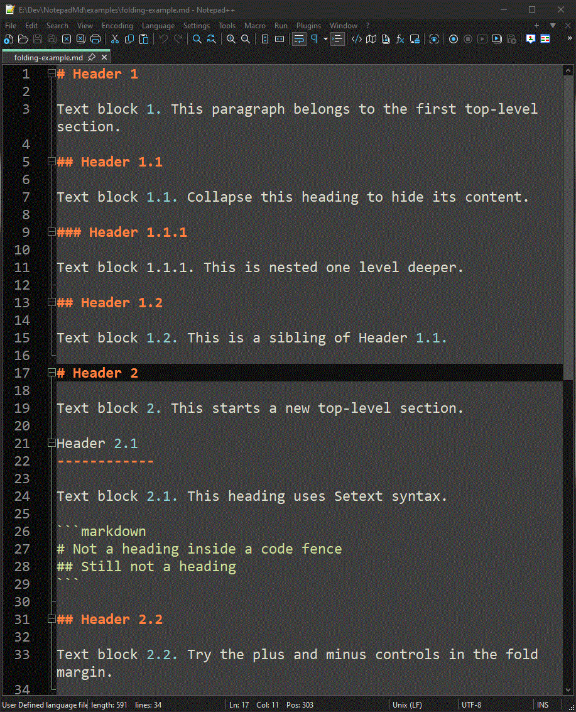

# NotepadMd

NotepadMd adds native heading folding to Markdown files in Notepad++. It uses
Notepad++'s existing fold margin and preserves the built-in Markdown syntax
highlighting and editing behavior.

## Example



## Features

- Plus and minus fold controls for ATX headings (levels 1 to 6) and
  Setext headings.
- Nested folds follow heading levels. Collapsing a heading hides its section up
  to the next heading of the same or higher level.
- Fenced code blocks are ignored when detecting headings.
- Fold levels refresh after edits, file changes, and language changes.
- A **Recompute Markdown folds** command is available from the Plugins menu.

This is a source editor enhancement, not a rendered Markdown preview. The
scanner does not implement every CommonMark container rule; headings inside
lists and blockquotes are not supported.

## Install

Download the x64 or Win32 ZIP that matches your Notepad++ architecture from the
GitHub [Releases](https://github.com/effelo/NotepadMd/releases) page. Extract it
into the Notepad++ plugins directory. The DLL should be at:

```text
Notepad++/
└── plugins/
    └── NotepadMd/
        └── NotepadMd.dll
```

Restart Notepad++. Open a `.md` or `.markdown` file using Notepad++'s Markdown
User Defined Language. Use the fold margin beside the line numbers to collapse
or expand sections.

## Build from source

Requires Windows, Git, and Visual Studio 2022 or its standalone Build Tools
with C++ desktop development tools. You can use VS Code and run the build
commands in its integrated PowerShell terminal.

The script locates MSBuild through the Visual Studio installer, so a Developer
PowerShell is not required:

```powershell
.\scripts\prepare-sdk.ps1
.\scripts\build.ps1 -Platform x64
```

Use `-Platform Win32` for 32-bit Notepad++. The DLL is written to
`build\<platform>\Release\NotepadMd.dll`. The plugin targets Notepad++ on
Windows; building the DLL on other operating systems is not supported.

The preparation script checks out the official plugin template at a pinned
revision in `.local/plugintemplate`, which Git ignores. It needs a network
connection on first use; subsequent builds use the local checkout. In the
release source archive, it verifies the bundled headers against the pinned
revision and SHA-256 values, so the same build commands work offline.

## Test

Run the scanner tests with the same Visual Studio toolchain:

```powershell
.\scripts\build.ps1 -Test
```

The test executable builds under `build\x64\Release`.

## How it works

NotepadMd scans the active editor buffer and sets Scintilla fold levels for
Markdown headings. Notepad++ draws and manages the fold controls. The plugin
does not replace the Markdown language, alter document text, or provide a
preview.

Notepad++'s built-in Markdown highlighting is a User Defined Language. Its
folding rules use literal triggers, which cannot express heading levels and
section boundaries. The plugin supplies those fold levels while leaving the UDL
active.

## References

- [Notepad++ Markdown support and release history][changes]
- [Notepad++ manual: folding][folding]
- [Notepad++ manual: User Defined Languages][udl]
- [Notepad++ manual: plugin development][plugin]
- [Notepad++ plugin template][template]
- [Scintilla folding API][scintilla]

[changes]: https://github.com/notepad-plus-plus/notepad-plus-plus/wiki/Changes
[folding]: https://npp-user-manual.org/docs/views/#folding
[udl]: https://npp-user-manual.org/docs/user-defined-language-system/
[plugin]: https://npp-user-manual.org/docs/plugins/#how-to-develop-a-plugin
[template]: https://github.com/npp-plugins/plugintemplate
[scintilla]: https://www.scintilla.org/ScintillaDoc.html#Folding

## License

Project-owned source is licensed under [GNU GPL version 3 or later](LICENSE).
The build uses upstream API headers under their own terms; see
[THIRD_PARTY_NOTICES.md](THIRD_PARTY_NOTICES.md).
